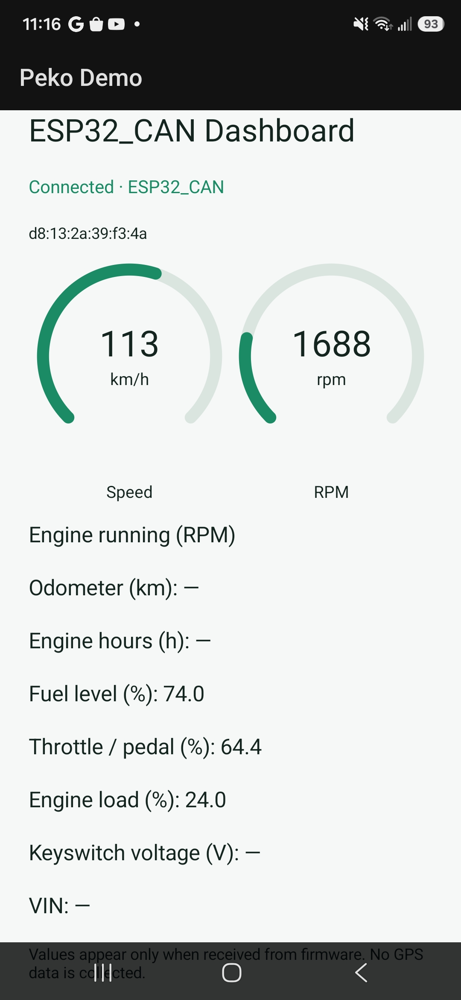

# Peko Demo — Android CAN Dashboard

Peko Demo connects directly to Peko hardware over Bluetooth Low Energy (BLE)
and displays vehicle telemetry on an Android dashboard. It receives decoded
CAN readings from the Peko firmware, rather than reading the vehicle bus
directly from the phone.

## Screenshot



## What the app does

- Automatically connects to the configured BLE MAC address without scanning.
- Displays speed and RPM gauges plus odometer, fuel level, throttle and pedal
  position, engine load, keyswitch voltage, GPS position (lat/lon), VIN, and
  engine hours when provided by firmware.
- Shows engine-running status inferred from RPM, not a confirmed ignition signal.
- Retries failed connections while the app is visible and offers a Reconnect button.
- Clears readings on disconnection; missing data is shown as `—`.
- Displays GPS latitude/longitude from the `g=` metric when the Peko hardware
  has a GNSS module and a valid fix. No location permission is requested and
  no position is stored.

Available readings depend on the vehicle, selected firmware protocol, and
which metrics the firmware actually publishes. This is a demonstration app,
not a certified vehicle diagnostic or safety system.

## Requirements

- **Peko hardware:** available from [Yakiot](https://yakiot.com).
- **Peko firmware:** source and flashing instructions at
  [yakiot/Peko](https://github.com/yakiot/Peko).
- A compatible vehicle/CAN source, or a suitable bench CAN emulator and power supply.
- An Android phone running **Android 11 (API 30) or newer**, with BLE support.
- Android Studio and the Android SDK required by the project's Gradle configuration.
- A USB data cable to flash the hardware and read its startup serial log.

## 1. Flash the Peko firmware

Follow the firmware repository's README to install PlatformIO and flash the
appropriate protocol environment: `heavy_duty_j1939` for supported J1939
networks or `passenger_obd2` for supported OBD-II CAN vehicles. Follow the
hardware's wiring and power specifications; do not connect the ESP32 GPIOs
directly to vehicle CAN wiring.

## 2. Find the hardware's BLE MAC address

Connect the hardware to your computer over USB and run these commands from
the firmware project directory:

```bash
pio device list
pio device monitor --baud 115200
```

Press the board's **EN / RESET** button while the monitor is open. Find the
startup line resembling this example:

```text
BLE address: AA:BB:CC:DD:EE:FF
```

Use the address printed by **your board**, not the example above or the
Wi-Fi MAC address. Close the monitor with **Ctrl+C** when finished.

## 3. Configure the MAC address before running Android

Edit `app/src/main/java/com/yakiot/peko/AppConstant.kt`:

```kotlin
object AppConstant {
    const val CAN_BLE_MAC_ADDRESS = "AA:BB:CC:DD:EE:FF"
    const val GPS_BLE_MAC_ADDRESS = "11:22:33:44:55:66"
}
```

Replace the address values with your boards' addresses; retain the other
constants in the file. `CAN_BLE_MAC_ADDRESS` is the CAN telemetry device and
`GPS_BLE_MAC_ADDRESS` is a second ESP32 used for GPS; either may be left blank
to disable that option on the start screen. Use six colon-separated
hexadecimal pairs. The app normalizes lowercase to uppercase before Android
validates the address.

The app does **not** scan for devices by name. On launch it shows a device
picker with CAN and GPS buttons; tapping one connects directly to the
configured address. You must configure the correct addresses and
rebuild/reinstall the app after changing these constants.

## 4. Run the Android app

1. Open this project in Android Studio and sync Gradle.
2. Enable Bluetooth on your Android phone and power the Peko hardware.
3. Connect your phone for Android development and select it as the run target.
4. Run the app. On Android 12+, grant the **Nearby devices / Bluetooth** permission.
5. The app connects directly, discovers the telemetry service, and subscribes
   to notifications. Once subscribed, the dashboard shows **Connected · ESP32_CAN**.
6. Supply compatible CAN traffic to see readings. A successful BLE connection
   alone does not generate vehicle data.

The connection closes when the app leaves the foreground and starts again
when you return. No Bluetooth scan or location permission is requested.

## Troubleshooting

- **Invalid BLE address:** check for six hexadecimal pairs separated by colons;
  remove copied labels or punctuation. Rebuild/reinstall after editing the constant.
- **Connection timeout:** verify the configured address, hardware power,
  Bluetooth permission, and firmware. Disconnect other BLE apps that may already
  be using the device, then tap **Reconnect**.
- **Connected but no readings:** confirm CAN wiring, bitrate, protocol environment,
  and vehicle/emulator traffic using the firmware's serial log. Unsupported or
  unavailable metrics stay blank.
- **Engine hours stay blank:** the firmware must publish `hours=` over BLE;
  printing engine hours to the serial console alone is not sufficient.

## BLE protocol

The app subscribes to service `7e140001-8c55-4a82-b345-51fa952a6a01`, telemetry
characteristic `7e140002-8c55-4a82-b345-51fa952a6a01`. Notifications are ASCII
`key=value` messages, including `rpm`, `speed`, `odo`, `fuel`, `thr`, `load`,
`keyv`, `hours`, `g` (GPS `lat,lon`), and `v` (VIN). Unknown fields are ignored.
